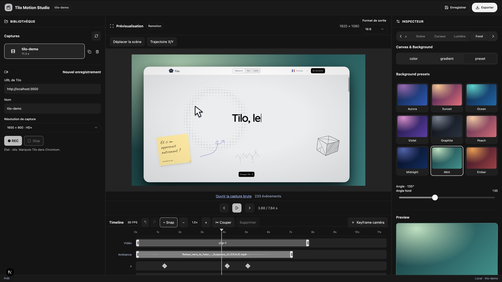

# Tilo Motion Studio

**A local-first screen recording and cinematic video editing studio for creating polished demonstrations of Tilo.**

Tilo Motion Studio records a running web application in Chromium, captures cursor interactions, and lets you compose and export presentation-ready videos using a browser-based editor. It combines **Playwright** for capture, **Remotion** for timeline-based rendering, and **Next.js / React** for the Studio interface.

> **Project status:** Active development / pre-1.0. Automated tests cover key workflows, but this is not yet a fully hardened, general-purpose video editor. See [Known limitations](#known-limitations).

## Screenshot



*The screenshot illustrates the Studio layout: project library and recording controls on the left, video preview and multitrack timeline in the center, and property inspectors on the right.*

## Features

- **Manual browser recording:** open a local Tilo page in Chromium, record video and capture pointer moves, clicks, and scrolls.
- **Automated scenarios:** script navigation, clicks, drags, waits, and supported Tilo bridge actions with Playwright.
- **Video editing:** arrange and split clips, trim clip boundaries, scrub the playhead, use snapping and timeline zoom.
- **Cinematic camera:** automatic click-driven zoom, manually configured camera keyframes, rotation, scene framing, and spatial X/Y animation.
- **Animated cursor:** selectable pointer styles, motion smoothing, click effects, and idle hiding.
- **Keyframe editing:** animate position, scale, rotation, and opacity with easing, Bézier curves, and spatial handles.
- **Audio:** import ambient music and voiceovers, adjust volume, trim, fades, mute/solo, and automatic ducking.
- **Appearance:** background colors, gradients, presets, padding, rounded corners, lighting, shadows, and vignette.
- **Projects:** list recordings, save editor settings, duplicate projects, and delete projects with confirmation.
- **Export:** render H.264 MP4 in landscape, portrait, or square formats. Export cancellation is available in the Studio.

Features and interface behavior may evolve; some advanced editing gestures and crash-recovery paths still require macOS acceptance testing.

## Technology stack

| Layer | Technology |
| --- | --- |
| Studio | Next.js 16 (App Router), React 19, TypeScript |
| UI | Arc-inspired components, Radix UI primitives, Motion, Lucide |
| Recording / browser automation | Playwright and Chromium |
| Video composition / preview | Remotion and Remotion Player |
| Audio/video inspection | FFmpeg and FFprobe (for relevant integration tests) |
| Validation | Zod |
| Tests | Vitest, Playwright E2E, GitHub Actions |
| Workspace | pnpm 10 |

The editor is served locally. It is **not** a hosted SaaS or a native macOS application.

## Requirements

- **Node.js 22** (the version used in CI).
- **pnpm 10.18.3** (declared by the root package).
- **Chromium for Playwright**, installed with the command below.
- **macOS** for the primary manual-recording workflow; CI also exercises headless Chromium on Linux.
- A running local Tilo instance for recording the actual application (normally `http://localhost:3000`).
- **FFmpeg / FFprobe** for media verification and certain test workflows.
- Enough free disk space for uncompressed/intermediate capture data and rendered MP4 files.

No external AI API key is required for the core capture and render workflow.

## Installation

```bash
git clone https://github.com/code-dev-pro/tilo-motion-studio.git
cd tilo-motion-studio
corepack enable
pnpm install
pnpm exec playwright install chromium
```

For Linux CI-style browser dependencies:

```bash
pnpm exec playwright install --with-deps chromium
```

> Dependency reproducibility: until a `pnpm-lock.yaml` is committed, the repository's CI uses `pnpm install --no-frozen-lockfile`. Committing a lockfile and restoring frozen installs is recommended.

## Start the Studio

Start the Tilo application separately on port **3000**, then run:

```bash
pnpm studio
```

Open **http://127.0.0.1:3333**. The Studio UI and its local API are bound to the local machine.

In the left panel, enter the local Tilo URL, a recording name, and a capture resolution. Click **REC**, interact with Tilo in the Chromium window, then use **Stop** to finalize the recording. Select the completed project from the library.

You can also close the capture window to request finalization; abrupt browser termination may leave an incomplete video.

### Editing workflow

1. Select a capture from the project library.
2. Scrub the timeline, trim and arrange video clips.
3. Configure the scene, background, cursor, camera, and property animations.
4. Add ambient audio or voiceover and adjust volume, fades, and ducking.
5. Save the project and choose an output format.
6. Export the MP4. The Studio exposes a cancellation action while rendering.

The source recording remains separate from the edited settings and rendered outputs.

## CLI usage

### Capture a scripted scenario

```bash
TILO_BASE_URL=http://localhost:3000 pnpm capture --scenario fixture
```

Available built-in scenarios are defined in `src/scenarios.ts`. The default fixture scenario is designed for testing; adapt scenarios and selectors to your local application.

### Render a saved manual recording

```bash
pnpm render --recording tilo-demo --format landscape
```

### Render a built-in scenario

```bash
pnpm render --scenario fixture --format portrait
```

Supported formats:

| Format | Resolution |
| --- | --- |
| `landscape` | 1920 × 1080 |
| `portrait` | 1080 × 1920 |
| `square` | 1080 × 1080 |

## Project files

Manual recordings are stored under `output/<recording-id>/`, for example:

```text
output/tilo-demo/
├── capture.webm          # Raw browser recording
├── events.json           # Pointer/click/scroll event timeline
├── event-diagnostics.json
├── manifest.json         # Source metadata and duration
├── scenario.json         # Scenario metadata
├── editor.json           # Saved editing settings
├── audio-*.mp3           # Imported audio (if present)
└── landscape.mp4         # Rendered output (if exported)
```

The `output/` directory is gitignored. **Back up projects before reinstalling, deleting folders, or making major upgrades.** Project deletion removes associated local media; there is currently no recycle bin.

## Testing and quality checks

```bash
pnpm test
pnpm typecheck
pnpm studio:build
pnpm exec tsx src/audit-pointer-smoke.ts
pnpm exec tsx src/audit-studio-e2e.ts
```

The E2E test starts a local production Studio and generates temporary test media. Avoid running another Studio process on port 3333 at the same time.

To verify an MP4 export using FFprobe:

```bash
TILO_AUDIT_RENDER=landscape TILO_AUDIT_AUDIO=1 pnpm exec tsx src/audit-studio-e2e.ts
```

GitHub Actions includes a three-format export matrix. Automated tests check technical properties such as video dimensions, H.264 encoding, duration, audio stream presence, and non-silence. They **do not** establish subjective audio or image quality.

## Known limitations

- **Local recording only:** manual capture URLs are restricted to `localhost` / `127.0.0.1`; arbitrary remote websites are not supported by the manual recorder.
- **Not a native desktop editor:** recording depends on a launched Chromium instance and the local Next.js server.
- **Browser closure and crash recovery:** normal closure is handled, but a forced Chromium kill can leave an unrecoverable or partially written WebM.
- **Audio quality:** the automated AAC checks verify that sound exists, not exact mix fidelity, perceived loudness, or the quality of voice ducking.
- **Editing maturity:** some advanced timeline gestures, complex multi-clip workflows, and keyframe interactions still need broader end-to-end coverage.
- **Export interruption:** cancellation may leave a partial MP4 file; do not treat it as a valid completed export.
- **Project deletion:** destructive and without an undo/trash feature.
- **Performance:** large recordings, high-resolution captures, and long multitrack projects have not been comprehensively benchmarked on every Mac.
- **Collaboration:** no cloud sync, multiuser collaboration, or account management.
- **Security:** the Studio is designed for trusted local use, not exposure to the public internet.

See `docs/FINAL_PRODUCTION_ACCEPTANCE.md` and other documents in `docs/` for validation checklists and current development gaps.

## Troubleshooting

**Studio cannot load Tilo:** confirm that Tilo is running on port 3000 and that the URL is local.

**No pointer events:** inspect `event-diagnostics.json` and run `pnpm diagnose:pointer`.

**No MP4 output:** inspect the render response and server logs; verify that `capture.webm` exists and that the project manifest is valid.

**React / Radix console warnings:** check the installed dependency tree, restart the Studio, and test the Select components after dependency updates.

**Port 3333 is occupied:** stop the previous Studio process before running a production build or E2E suite.

## Development

Source code is organized around `apps/studio/` (Next.js interface and local API), `src/` (recording, composition, editing, rendering), `tests/` (unit tests), and `.github/workflows/` (CI).

This project is primarily intended for producing Tilo educational product demonstrations. It is not affiliated with or endorsed by the maintainers of Playwright, Remotion, Radix UI, or Next.js.
